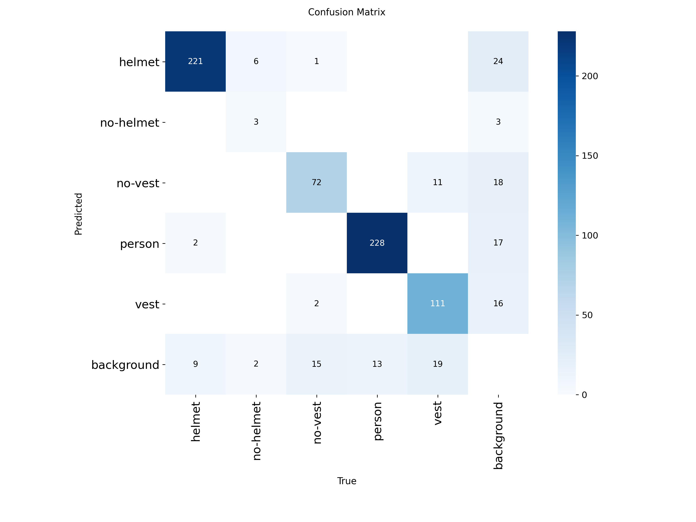

# 🦺 Safety-Vision: Detector de EPIs em Tempo Real com YOLOv8

> **Status:** Concluído ✅  
> **Modelo:** YOLOv8 (Object Detection)  
> **mAP50 (All Classes):** 0.83  
> **Velocidade de Inferência:** ~1.8ms/frame (Tesla T4)

Este projeto de Visão Computacional utiliza **Deep Learning** para monitoramento automático de segurança em canteiros de obras, identificando o uso correto de Equipamentos de Proteção Individual (EPIs) como capacetes e coletes em tempo real.

O sistema foi desenvolvido com a arquitetura **YOLOv8 (You Only Look Once)**, conhecida por sua velocidade e precisão, permitindo inferência em tempo real com alta taxa de frames.


---

## 📸 Demonstração

<p align="center">
  
</p>

*Sistema detectando automaticamente pessoas, capacetes e coletes em vídeo de canteiro de obras*

---

## 🗂️ Estrutura do Projeto

```text
ppe-detector-yolo/
│
├── notebooks/
│   └── training.ipynb   # Notebook de treinamento e análise
│
├── src/
│   └── inference.py     # Script principal de inferência
│
├── weights/
│   └── best.pt          # Pesos do modelo treinado
│
├── assets/              # Imagens e GIFs para documentação
│
├── requirements.txt     # Dependências do projeto
│
└── README.md            # Este arquivo
```

---

## 🛠️ Tecnologias Utilizadas

- **Ultralytics YOLOv8:** Framework de detecção de objetos state-of-the-art
- **PyTorch:** Backend de Deep Learning
- **OpenCV:** Processamento de vídeo e visualização
- **Python 3.10+:** Linguagem base do projeto
- **Google Colab:** Ambiente de treinamento com GPU

---

## 🧠 Sobre o Projeto

A segurança em canteiros de obras é **crítica** e regulamentada por normas trabalhistas. Este projeto automatiza o monitoramento de conformidade com EPIs obrigatórios, reduzindo riscos de acidentes.

### 🔹 Funcionalidades

- ✅ **Detecção de Pessoas** em tempo real
- ✅ **Verificação de Capacete** (Helmet) e **Colete** (Vest)
- ⚠️ **Alertas visuais** para ausência de EPIs (No-Helmet / No-Vest)
- 📊 **Estatísticas em tempo real** na tela
- 🎥 **Processamento de vídeo** com saída anotada

### 🔹 Classes Detectadas

| Classe | Descrição | Cor do Bbox |
|--------|-----------|-------------|
| 👷 **Person** | Pessoa detectada | Azul |
| ⛑️ **Helmet** | Capacete presente | Verde |
| 🦺 **Vest** | Colete presente | Verde |
| 🚫 **No-Helmet** | Ausência de capacete | Vermelho |
| 🚫 **No-Vest** | Ausência de colete | Vermelho |

---

## 📊 Métricas de Desempenho

O modelo foi treinado por **30 épocas** com resolução de entrada de **640x640**. Abaixo estão os resultados obtidos no conjunto de validação:

### 🔹 Resultados por Classe

| Classe | Precision (P) | Recall (R) | mAP50 | mAP50-95 | Status |
|--------|---------------|-----------|-------|----------|--------|
| **All (Geral)** | **0.73** | **0.82** | **0.83** | **0.61** | 🟢 Ótimo |
| 👷 Person | 0.85 | 0.95 | **0.94** | 0.77 | 🟢 Excelente |
| ⛑️ Helmet | 0.77 | 0.96 | **0.93** | 0.72 | 🟢 Excelente |
| 🦺 Vest | 0.81 | 0.86 | **0.90** | 0.63 | 🟢 Excelente |
| 🚫 No-Helmet | 0.54 | 0.43 | 0.56 | 0.36 | 🟡 Atenção* |
| 🚫 No-Vest | 0.68 | 0.71 | 0.73 | 0.55 | 🟢 Bom |

> **\*Nota Técnica:** A classe `No-Helmet` apresenta métricas mais baixas devido ao **desbalanceamento do dataset**. Há significativamente mais exemplos de operários *com* capacete do que *sem*, o que dificulta a aprendizagem da classe minoritária. Este é um ponto de melhoria mapeado para versões futuras através de técnicas de balanceamento e data augmentation.

**Matriz de Confusão:**
<p align="center">
  
</p>
> *Observe a confusão maior nas classes 'No-Helmet' e 'No-Vest', confirmando a necessidade de mais dados para esses cenários.*

### 🔹 Performance de Inferência

| Métrica | Valor |
|---------|-------|
| **Velocidade (GPU T4)** | ~1.8ms por frame |
| **FPS Estimado** | ~550 FPS |
| **Tamanho do Modelo** | ~6.2 MB |
| **Parâmetros** | ~3.0M |

---

## 🎯 Análise de Resultados

### ✅ Pontos Fortes

- **Alta precisão em detecção de pessoas** (0.95 Recall) - praticamente não perde operários na cena
- **Excelente identificação de EPIs corretos** (Helmet e Vest com mAP50 > 0.90)
- **Velocidade de inferência** permite uso em tempo real
- **Modelo leve** (~6MB) viabiliza deploy em edge devices

### ⚠️ Desafios Identificados

- **Classe No-Helmet sub-representada** - Precision de 0.54 e Recall de 0.43
- **Necessidade de balanceamento** para melhorar detecção de violações de segurança
- **Possível viés do modelo** em favorecer detecção de conformidade vs. não-conformidade

---

## ⚙️ Como Executar

### 1️⃣ Clone o repositório

```bash
git clone https://github.com/seu-usuario/ppe-detector-yolo.git
cd ppe-detector-yolo
```

### 2️⃣ Crie um ambiente virtual (Recomendado)

```bash
python -m venv venv
source venv/bin/activate  # Linux/Mac
# ou
venv\Scripts\activate     # Windows
```

### 3️⃣ Instale as dependências

```bash
pip install -r requirements.txt
```

### 4️⃣ Execute a inferência em vídeo

```bash
python src/inference.py --source video_teste.mp4 --output resultado.mp4 --conf 0.5
```

### 5️⃣ Execute em tempo real (Webcam)

```bash
python src/inference.py --source 0 --conf 0.5
```

---

## 🎛️ Argumentos da Linha de Comando

| Argumento | Descrição | Padrão | Exemplo |
|-----------|-----------|--------|---------|
| `--source` | Vídeo de entrada ou webcam | - | `video.mp4` ou `0` |
| `--output` | Arquivo de saída | `output.mp4` | `resultado.mp4` |
| `--conf` | Limiar de confiança | `0.5` | `0.6` |
| `--model` | Caminho dos pesos | `weights/best.pt` | `custom_weights.pt` |
| `--device` | GPU ou CPU | `auto` | `cuda` ou `cpu` |

**Exemplo completo:**

```bash
python src/inference.py \
  --source construcao.mp4 \
  --output analise_seguranca.mp4 \
  --conf 0.6 \
  --device cuda
```

---

## 📦 Dependências Principais

```text
# Deep Learning
ultralytics>=8.0.0
torch>=2.0.0
torchvision>=0.15.0

# Processamento de Vídeo
opencv-python>=4.8.0
opencv-contrib-python>=4.8.0

# Utilidades
numpy>=1.24.0
pandas>=2.0.0
matplotlib>=3.7.0
pillow>=10.0.0

# Ambiente de Desenvolvimento
jupyter>=1.0.0
ipython>=8.12.0
```

---

## 🧪 Treinamento do Modelo

O modelo foi treinado utilizando o seguinte pipeline:

### 🔹 Configuração de Treinamento

```python
from ultralytics import YOLO

# Carregar modelo pré-treinado
model = YOLO('yolov8n.pt')

# Treinar no dataset customizado
results = model.train(
    data='dataset.yaml',
    epochs=30,
    imgsz=640,
    batch=16,
    device=0,
    patience=10,
    save=True,
    cache=True
)
```

### 🔹 Dataset

- **Fonte:** Roboflow Universe - Construction Safety Dataset
- **Total de Imagens:** ~5.000 imagens anotadas
- **Split:** 70% Treino / 20% Validação / 10% Teste
- **Augmentations:** Flip horizontal, rotação, zoom, brightness

---

## 🚀 Roadmap: Próximos Passos

### 🔹 1. Balanceamento do Dataset

- Coletar mais imagens de situações de **não-conformidade** (No-Helmet, No-Vest)
- Aplicar **data augmentation** agressivo nas classes minoritárias
- Utilizar **weighted sampling** durante o treinamento

### 🔹 2. Lógica de Zonas de Perigo

- Implementar detecção de **zonas críticas** (polígonos definidos pelo usuário)
- Alertas específicos quando operários sem EPIs entram em áreas perigosas
- Sistema de notificação em tempo real

### 🔹 3. Otimização para Edge Devices

- Conversão para **TensorRT** para Jetson Nano
- Quantização do modelo para **ONNX Runtime**
- Deploy em **Raspberry Pi 4** com Coral TPU

### 🔹 4. Sistema de Alertas

- Integração com **sistema de som** para alertas sonoros
- Dashboard web para **monitoramento remoto**
- Logs de violações de segurança com timestamp e captura de tela

### 🔹 5. Expansão de EPIs

- Adicionar detecção de **luvas de segurança**
- Identificar **calçados de proteção**
- Reconhecer **óculos de proteção**

---

## ✅ Principais Aprendizados

- **YOLOv8 em produção:** Implementação completa de pipeline de detecção em tempo real
- **Desbalanceamento de classes:** Impacto crítico nas métricas de classes minoritárias
- **Trade-off Precision/Recall:** Em aplicações de segurança, alto Recall é mais importante (melhor ter falsos positivos que miss)
- **Otimização de inferência:** Técnicas para acelerar processamento de vídeo
- **Computer Vision aplicada:** Solução de problema real da indústria

---

## 🎯 Conclusão

O **Safety-Vision** demonstra a aplicabilidade de Deep Learning em **segurança do trabalho**, alcançando métricas competitivas (mAP50 de 0.83) e velocidade adequada para uso em tempo real.

**Conquistas:**
- ✅ Detecção robusta de pessoas e EPIs básicos
- ✅ Inferência em tempo real (~1.8ms/frame)
- ✅ Modelo leve e deployável
- ✅ Pipeline completo de treinamento e inferência

**Desafios e Próximos Passos:**
- ⚠️ Melhorar detecção de não-conformidades através de balanceamento
- 🔄 Implementar lógica de zonas e alertas inteligentes
- 🚀 Otimizar para deploy em dispositivos edge

Este projeto serve como base sólida para sistemas de **monitoramento automatizado de segurança**, com potencial de expansão para múltiplos cenários industriais.

---

## 📌 Autor

Desenvolvido por **Álvaro Braz Cunha**.

[](https://www.linkedin.com/in/alvaro-braz-cunha)

Projeto desenvolvido para fins de **estudo, pesquisa e portfólio profissional em Visão Computacional e Deep Learning**.

---

## 📄 Licença

Este projeto está sob a licença MIT. Veja o arquivo `LICENSE` para mais detalhes.

---

## 🙏 Agradecimentos

- **Roboflow Universe:** Dataset de Construction Safety
- **Ultralytics:** Framework YOLOv8
- **Google Colab:** Infraestrutura de treinamento com GPU gratuita
- **Comunidade de Computer Vision:** Por compartilhar conhecimento sobre detecção de objetos